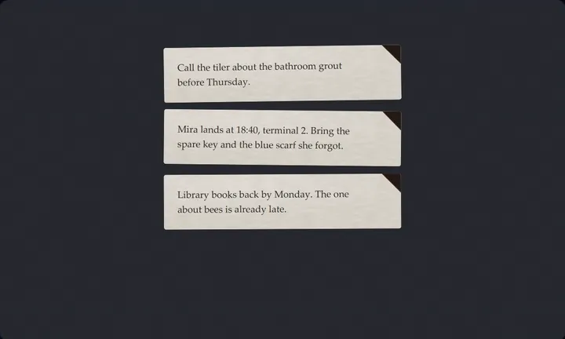

# Stringless

Make your UI speak for itself.

Stringless is an agent skill for designing interfaces that need no text labels. Each control shows what it does through material, motion, form, space and time. It's a new, experimental approach by [Basel Ashraf](https://baselashraf.com).

**Live demo: [stringless.baselashraf.com](https://stringless.baselashraf.com)**



## Install

Claude Code:

```
/plugin marketplace add BaselAshraf81/stringless
/plugin install stringless@stringless
```

The plugin also adds two hooks. After the agent edits a file that uses Stringless, one runs `stringcheck` on it and hands the agent what it found. In a project with a Stringless `LEXICON.md`, the other tells the agent at the start of each session, so new controls follow the lexicon even when you don't name the skill. Set `STRINGLESS_HOOK=0` to turn them off. They need Node 18 or later, like the scripts.

Cursor, Codex, Gemini CLI, Copilot, Kiro and other tools that read [Agent Skills](https://agentskills.io):

```
npx skills add BaselAshraf81/stringless
```

You can also copy `skills/stringless` into your tool's skills folder, such as `.claude/skills/` or `~/.kiro/skills/`. For claude.ai, zip that folder and upload it as a skill. The scripts need Node 18 or later.

## Use

```
/stringless forge a delete control for my notes
```

In Codex, type `$stringless`. In other tools, name the skill in your request.

| Command | What it does |
|---|---|
| `init` | Learns the product and writes PRODUCT.md and FEATURES.md |
| `lexicon` | Decides what each material, motion and phase means in your product |
| `map` | Finds every label on a screen |
| `stage` | Wireframes a screen as a stage |
| `forge` | Builds one control, end to end |
| `unstring` | Takes the labels off existing UI without changing what it does |
| `dream` | Three wild concepts before any code |
| `guess` | A reader who sees only pixels predicts what each control does |
| `audit` | Checks access, keyboard, touch, reduced motion and speed |
| `tune` | Pushes one channel further |

## The method

Before you commit, a control answers five questions without a word:

| Question | Channel | Example |
|---|---|---|
| What is it? | material and form | a sheet of paper is a document |
| What does it touch? | space | the card wakes up as you come near |
| What will it do? | motion | the corner starts to char |
| What does it cost? | physics | burning takes a hold, saving takes a tap |
| Where is it in time? | phase | wet ink is unsaved, dry ink is saved |

Agents reach for the same few ideas, like a paper plane for send. So before it invents anything, the skill rolls random seeds from 92 materials, 50 crafts, 53 natural effects and 60 mechanisms. The agent has to use one or say why each one lost.

## The words are still there

- Every control has a name that screen readers read, and the same name feeds the captions.
- Press `?`, long-press or linger, and the words come back.
- Keyboard and touch get everything hover gets.
- Previews never change data.
- Heavy actions take a hold and leave an undo.
- Reduced motion keeps the meaning.
- Content keeps its words: names, prices, dates and errors.

`scripts/stringcheck.mjs` checks these rules with no LLM and no network.

## What's inside

- `skills/stringless/`: the skill, its reference files and a catalog of 160 starting concepts.
- `skills/stringless/assets/runtime/`: `stringless.js` (16 KB gzipped) and `stringless.css`. No framework needed; it runs on data attributes. Add it to a project with `node skills/stringless/scripts/install-runtime.mjs`.
- `skills/stringless/assets/examples/`: the six controls from the demo. Run `node skills/stringless/scripts/serve.mjs .` and open http://127.0.0.1:4173/gallery/.
- `site/`: the demo site.

Run the tests with `node tests/run.mjs`. They need Node 22 or later and Chrome or Edge.

## Credits

Made by [Basel Ashraf](https://baselashraf.com).

The project's shape, one skill with commands and shared context files, follows [Impeccable](https://github.com/pbakaus/impeccable) by Paul Bakaus. The two work together: Impeccable owns the visual design and Stringless owns how controls show intent. Impeccable is licensed under Apache 2.0. Its license and notice are in [third_party/impeccable](third_party/impeccable).

## License

MIT. See [LICENSE](LICENSE).
