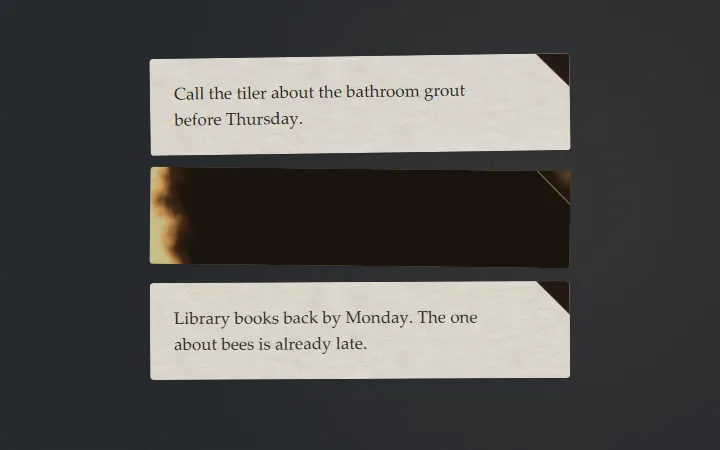
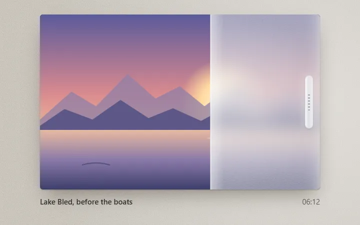
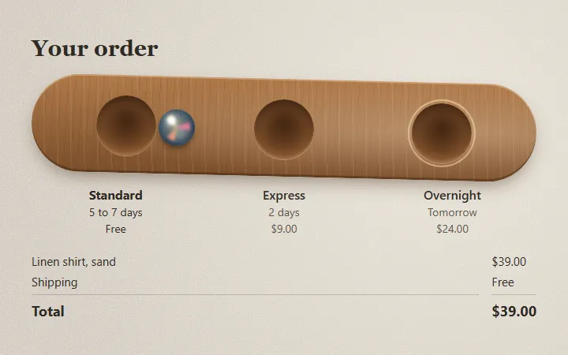
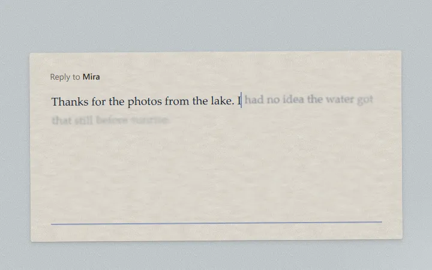
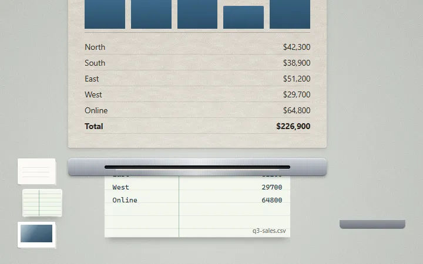
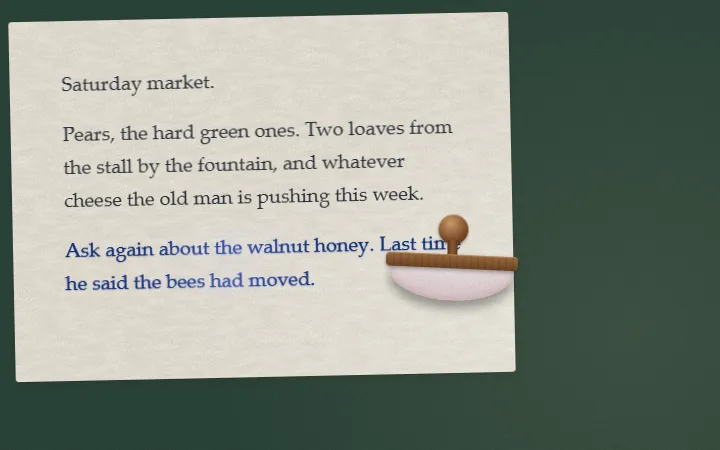

# Stringless

A skill for Claude Code and other coding agents that builds interface parts which explain themselves without text labels.

| | | |
|---|---|---|
|  |  |  |
| **Delete.** The corner chars as you near it and burns while you hold. The ash it leaves is the undo. | **Privacy.** Hovering slides frosted glass over the photo, so you see how others will see it. | **Choice.** One marble, three wells. Hover a well and the tray tips toward it. |
|  |  |  |
| **AI suggestions.** Mist after your cursor; less certain words are mistier. Tab condenses it into ink. | **Export.** The print slides out of the slot already in its format: a page, a ledger strip, a photo. | **Save.** Unsaved paragraphs are wet ink. The blotter rocks across them and they dry. |

None of these has a word on it. Each one still has a name for screen readers, works from the keyboard, and keeps its meaning with reduced motion. To try them, clone the repo, run `node skills/stringless/scripts/serve.mjs .` and open http://127.0.0.1:4173/gallery/.

## Why

Ask an agent for a delete button and you get a rounded rectangle with the word "Delete", maybe a red fill and a trash can, and an "Are you sure?" dialog. The word does all the work and the shape says nothing.

Label-free design has been tried before, and it usually fails: icons nobody can read, meaning hidden in tooltips. Stringless is a method for doing it so it works. Before the user commits, a control answers five questions without words:

| Question | Channel | Example |
|---|---|---|
| What is it? | material and form | a sheet of paper is a document |
| What does it touch? | space | the card it sits on wakes up as you approach |
| What will it do? | motion | the corner starts to char: it will burn |
| What does it cost? | physics | you hold while the heat builds |
| Where is it in time? | phase | unsaved text is wet ink, saved text is dry |

Two ladders shape every design. The signifier ladder ranks how a control explains itself: it previews its effect on the real target, it's bound to what it affects, it borrows a real material, and only then a symbol or a word, which are fallbacks. The intent ladder says how a control reveals more as you give it attention: rest, approach, rehearse, commit, echo, memory.

## Install

**Claude Code**, as a plugin:

```
/plugin marketplace add BaselAshraf81/stringless
/plugin install stringless@stringless
```

**Any agent that reads Agent Skills** (Cursor, Codex, Gemini CLI, GitHub Copilot, Kiro, OpenCode, Windsurf and many more), with the [skills CLI](https://github.com/vercel-labs/skills):

```
npx skills add BaselAshraf81/stringless
```

**By hand**: copy `skills/stringless` into your tool's skills folder.

| Tool | In a project | For every project |
|---|---|---|
| Claude Code | `.claude/skills/` | `~/.claude/skills/` |
| Codex CLI | `.agents/skills/` | `~/.agents/skills/` |
| Cursor | `.cursor/skills/` | |
| GitHub Copilot | `.github/skills/` | |
| Gemini CLI | `.gemini/skills/` | |
| Kiro | `.kiro/skills/` | `~/.kiro/skills/` |
| OpenCode | `.opencode/skills/` | |

**claude.ai**: zip the `skills/stringless` folder and upload it as a skill. The frontmatter uses only Agent Skills fields, so the upload passes validation.

The scripts need Node 18 or later. The plugin also installs the `cold-reader` subagent used by `guess`; other installs fall back to a fresh subagent or ask you to show the screenshots to someone.

## Use

In Claude Code type `/stringless` (as a plugin, `/stringless:stringless` also works). In Codex use `$stringless`. In other tools, name it in your request, or ask for label-free UI and the skill loads itself.

```
/stringless init
/stringless forge a delete control for the note cards
/stringless unstring the settings page
/stringless dream the share button
/stringless guess the editor toolbar
/stringless audit src/components
```

| Command | What it does |
|---|---|
| `init` | Learns the product. Writes PRODUCT.md if missing, and FEATURES.md |
| `lexicon` | Builds LEXICON.md: the world the product lives in, and what each material, verb, weight and phase means |
| `map` | Lists every visible string on a surface and turns each into an intent |
| `stage` | Wireframes a surface as a stage: objects, tools, bindings, reach, light and gravity |
| `forge` | Designs and builds one stringless component end to end |
| `unstring` | Converts an existing labeled UI without changing what it does |
| `dream` | Three concepts at rising strangeness from a fresh roll; no code until you pick |
| `guess` | Cold read: a reader who sees only pixels predicts what each control does |
| `audit` | Accessibility, keyboard, touch, reduced motion, performance and lexicon checks |
| `tune` | Deepens one channel (material, motion, form, space, time, sense) of a component |

## How it works

**Context files.** `PRODUCT.md` says who the product is for. If Impeccable or another tool already wrote one, Stringless reads it and leaves it alone. `FEATURES.md` lists each feature's objects, verbs, weights and states. `LEXICON.md` is the product's own vocabulary: one material per meaning, one choreography per verb, so a user who learns that ash means "you can still undo" can read it everywhere.

**The roll.** Models converge on the same few ideas: paper planes for send, trash cans for delete, sparkles for AI. Before inventing anything, the skill runs `scripts/roll.mjs`, which draws random seeds from 92 materials, 50 crafts, 53 natural phenomena, 60 mechanisms, 45 scenes, 25 physical properties, 22 time behaviors and 45 design constraints, and skips anything in the lexicon's `Tried` list. The agent must use a seed or say in one line why each one lost.

**Strangeness.** Each surface gets a level from 1 (a familiar control with one stringless touch) to 5 (an art piece where discovery is the point). The default is 3. Daily tools and creative apps can go high; checkout and one-time flows stay low.

**Channels and catalog.** Six reference files teach the channels: material, motion, form, space, time, and opt-in sound and haptics. The catalog holds 160 starting concepts for 63 common needs, from save and delete to sliders, empty states, AI suggestions and agent activity. They are starting points to beat, not templates.

**Verification.** `scripts/stringcheck.mjs` is a deterministic detector with no LLM and no network. It flags controls with no accessible name, controls the keyboard can't reach, words painted onto stringless controls, hover-only meaning, removed focus outlines, motion with no reduced-motion handling, idle loops, and rehearsal handlers that write data. `guess` runs a cold read with a subagent that only sees screenshots.

## The runtime

`skills/stringless/assets/runtime/` holds `stringless.js` (16 KB gzipped, no dependencies) and `stringless.css` (5 KB gzipped). It works with any framework because it runs on data attributes and CSS variables. Copy it into a project with `node skills/stringless/scripts/install-runtime.mjs`.

```html
<article class="card" data-sl-material="paper">
  <p>Call the tiler before Thursday.</p>
  <button data-sl-verb="delete" data-sl-weight="heavy" data-sl-target="closest(.card)" aria-label="Delete note"></button>
</article>
```

The card now answers the button's approach (`--sl-near`), rehearses the delete on hover and focus (`data-sl-preview="delete"`, `--sl-rehearse`), needs a hold to commit with two presses as the keyboard path (`--sl-hold`), and shows "Delete note" as a caption when someone hesitates. The runtime also gives you material light, springs from material physics, shatter, dissolve, fold, travel, pour, ripple, refuse, settle and crystallize, remnants for undo, fluency that quiets controls you use often, patina from wear, and opt-in sound and haptics. The full reference is in [reference/runtime.md](skills/stringless/reference/runtime.md).

## The floor

Stringless takes words off the screen, never out of the experience:

- Every control has a role and an accessible name, and the same name feeds the captions.
- Captions on demand: press `?`, long-press, or linger.
- Keyboard focus and touch-hold reveal everything a pointer approach reveals.
- Rehearsals only preview. They never change data.
- Heavy actions take a hold or two presses and leave an undo.
- Reduced motion keeps the meaning, not just the stillness.
- Content keeps its words: names, prices, dates, errors and legal text.

## With other design skills

Stringless doesn't replace a visual design skill. When [Impeccable](https://github.com/pbakaus/impeccable) is installed, it owns the visual world, type and layout through DESIGN.md, and Stringless owns how controls express intent. Both read the same PRODUCT.md.

## Native apps

The method maps to SwiftUI, Jetpack Compose, Flutter and React Native: press states for rehearsal, platform springs from the same physics presets, shaders for materials, real haptics. See [reference/native.md](skills/stringless/reference/native.md). The runtime itself is web-only.

## Develop

```
node tests/run.mjs               # skill structure, scripts, and every example in headless Chrome
node tests/run.mjs --no-browser  # skip the browser scenarios
```

Needs Node 22 or later and Chrome or Edge. Set `CHROME` to the browser's path if it isn't found.

## Credits

Made by [Basel Ashraf](https://baselashraf.com). The shape of the project, one skill with commands and shared context files, follows [Impeccable](https://github.com/pbakaus/impeccable) by Paul Bakaus.

## License

MIT. See [LICENSE](LICENSE).
